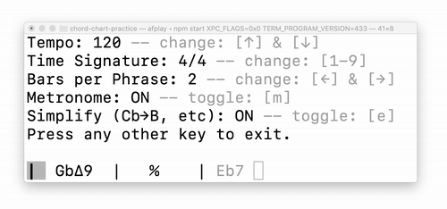

# chord-chart-practice
A little tool that prints out semi-random chords at a given tempo, which I've been using to practice jazz chords/keeping up with a chord chart. It has options to configure tempo, time-signature, and more. The chord changes are statistically derived from real jazz standards!



```bash
# to install
npm install

# to run:
npm start
```

`resources/cadenceData.json` is a representation of the qualities and motion of every neighboring 3 chords in the iReal 1300 standard songbook. Re-generate that data with `npm run genCadenceData`.

## Credits

The music theory, as with all my music-related projects, is handled by the incredible [tonaljs](https://tonaljs.github.io/tonal/).

Click sound effect is adapted from this Metronome sound effect by Mike Koenig, which is under an Attribution 3.0 license: https://soundbible.com/914-Metronome.html

Chord quality/motion probabilities are adapted from the iRealPro 1300 standard songbook, and extracted using [ItsGiusto/ireal-parse](https://github.com/ItsGiusto/ireal-parse/tree/master).
